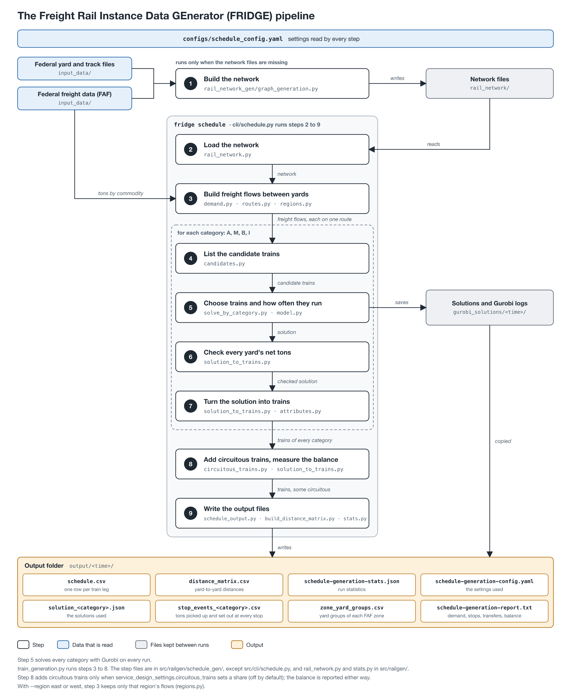

# FRIDGE: Schedule Generation

What `uv run fridge schedule` does. Entry point: `generate_schedule` in `src/cli/schedule.py`. Train generation is `train_generation.py` and the modules it calls in this folder.

---

## Overview

FRIDGE generates a one-week train schedule on the US rail network. Freight flows come from the Freight Analysis Framework (FAF); a service network design model (a mixed-integer program, solved with Gurobi) decides which trains run, how often and what they carry. One model is solved per train category:

| Category | Trains     | Freight                                                                   |
| -------- | ---------- | ------------------------------------------------------------------------- |
| `A`      | Automotive | Motor vehicles and transport equipment                                    |
| `M`      | Manifest   | Everything not in another category                                        |
| `B`      | Bulk       | Coal, grain, ores and minerals, aggregates, petroleum and energy products |
| `I`      | Intermodal | FAF "multiple modes" freight                                              |

| Step | What happens                                            | Main files                                                                                           |
| ---- | ------------------------------------------------------- | ---------------------------------------------------------------------------------------------------- |
| 1    | Build or load the rail network                          | `rail_network.py`, `rail_network_gen/graph_generation.py`                                            |
| 2    | Freight flows, candidate trains, one model per category | `train_generation.py`, `demand.py`, `routes.py`, `candidates.py`, `solve_by_category.py`, `model.py` |
| 3    | Turn each solution into timed trains                    | `solution_to_trains.py`, `circuitous_trains.py`                                                      |
| 4    | Write output                                            | `cli/schedule.py`, `schedule_output.py`, `build_distance_matrix.py`                                  |
| 5    | Write statistics                                        | `stats.py`                                                                                           |



**Output** (in `output/<timestamp>/`):

- **`schedule.csv`**: one row per segment of every train (Step 4).
- **`distance_matrix.csv`**: km and minutes between every pair of yards in the schedule.
- **`schedule-generation-config.yaml`**: the settings the run used.
- **`schedule-generation-report.txt`**: freight kept and dropped, stops and transfers per category, locomotive balance.
- **`schedule-generation-stats.json`**: the console statistics.
- **`solution_<category>.json`**, **`stop_events_<category>.csv`**: each category's model solution, as solved, and the stops of its trains after the empty legs are cut (Step 3).
- **`zone_yards.csv`**: the yards that represent each FAF zone (1e); `hub_city` names the hub cities whose hub a yard is (Routing Graph, phase 1).

---

## Requirements and Options

Gurobi needs a full license (free for academic use); the one bundled with `gurobipy` is too small. Every run solves every category; solutions and logs go to `gurobi_solutions/<timestamp>/`.

Run `uv run fridge schedule --help` to view all schedule generation options.

The seed sets only each train's running days and start time, from one generator per category (seeded by the seed and the category); the trains themselves come from the model. It is written into the run's `schedule-generation-config.yaml` as `general_settings.train_seed`.

---

## Step 1: Build the Rail Network

`RailNetwork(config)` calls `generate_or_load_network`, which returns the yards (`yds_dict`, keyed `YARDNAME-OBJECTID`) and an undirected graph of them (`yds_graph`, edges in km). Cached in `rail_network/`:

| File                                           | Contents                                            |
| ---------------------------------------------- | --------------------------------------------------- |
| `yard_records.json`                            | Every NTAD yard record with elevation and city (1a) |
| `graph.gexf`                                   | The yard graph before pruning (1c)                  |
| `yds_dict.json`                                | The yards and the FAF zone each represents (1e)     |
| `hub_coords.json`                              | Geocoded hub cities                                 |
| `edge_grades.json`                             | Ruling grade of each routed hop (Step 3)            |
| `all_distances_grade<g>_max<m>_window<w>.json` | Cached distances for `distance_matrix.csv` (Step 4) |

Missing files are rebuilt; existing ones are read. After changing the zone settings or merges, delete `yds_dict.json`; after changing drops or the track in use, also delete `graph.gexf`; after any network change, delete the `all_distances_*.json` files and `edge_grades.json`.

### 1a. Yard Records (`load_yard_records`)

One `Yard` per record of the NTAD Rail Yards file (downloaded if missing), with its first coordinate, its elevation (Copernicus GLO-90 DEM), its city and state (BigDataCloud reverse geocoding; needs `BDC_KEY`), its owner, and its track length `shape_length_km`, which ranks yards by size.

### 1b. Yard Changes (`yd_changes.csv`)

Hand fixes to the yard records in `src/railgen/rail_network_gen/yd_changes.csv`; only rows with `apply` = `yes` are used:

- **`merge`**: another record of the same yard; folded into `merge_into`, which gets both track lengths.
- **`drop`**: not a freight yard (passenger or tourist); left out of the graph.
- **`bar`**: stays in the network but cannot represent a FAF zone.

### 1c. Building the Graph (`build_or_load_graph`)

A walk over the North American rail lines (`custom_dijkstra`) goes out from each yard until it reaches another; each edge is the shortest track distance (km) between two directly connected yards. Lines with a `NET` code in `network_settings.excluded_track_net_codes` are skipped. A merged record's track belongs to its yard; a dropped record's track is ordinary track.

### 1d. Pruning (`drop_long_edges`, `drop_redundant_edges`, `drop_bypassed_edges`)

Done on every load; `graph.gexf` keeps every edge.

- **Long connections:** edges over `network_settings.max_connection_km`. The yards file is US-only, so a route through Canada or Mexico becomes one long edge with no yard, and so no crew change, on it.
- **Edges that skip a yard:** edge A–C goes when some path A–…–C is shorter, or at most `SAME_TRACK_TOLERANCE` (`constants.py`) longer, so a train on A–C does not pass yards that are not on its path. Paths through one yard are checked first, then paths through any number (longest edges first, keeping the graph connected).

### 1e. FAF Zone Yards (`assign_od_yards`)

Every yard lies in the FAF6 zone whose boundary contains it (`input_data/FAF6/`, the 2022 CFS geography shapefile; downloaded if missing). A yard outside every zone but within `FAF_ZONE_TOLERANCE_KM` (`constants.py`) of one belongs to it: a yard's first track point can sit just over a zone boundary, as at El Paso on the Mexican border.

Each zone that sends or receives rail or multimodal freight (`input_data/FAF6.0.csv`) is represented by up to `network_settings.yds_per_zone` of its yards, largest first; freight of the zone starts and ends at them. Barred yards (1b) are skipped, as are candidates within `min_od_yd_spacing_km` of track of one already chosen and candidates under `min_od_yd_track_km` of track (waived when a zone has none that large). A zone with no yard inside is not represented, and its freight is dropped.

---

## Step 2: Generate Trains

`generate_trains` builds the freight flows once, grades the track of every routed hop (Step 3), then per category: candidate trains, the model, the yard balance check, and the trains (Step 3). Settings are under `service_design_settings` unless noted.

### 2a. Freight Flows (`build_commodities` in `demand.py`)

A _commodity_ is the freight of one train type from an origin to a destination yard, in tons per week: one freight group, or with `shared_bulk` all B groups together (as manifest freight of many SCTG codes is one commodity).

1. **Read FAF rows** with mode rail or multiple modes, every trade type (domestic part of imports and exports): 2022 tons × 1000 / 52. A multiple-modes row counts `multimodal_rail_share` of its tons, and only on zone pairs whose multiple-modes freight averages between `multimodal_min_miles` and `multimodal_max_miles` (FAF5 ton-miles / tons). Rows of `excluded_zones` are dropped.
2. **Freight group and train type:** multiple-modes rows are `intermodal`; rail rows map their SCTG code through `freight_groups`, unlisted codes being `manifest`. `train_type_category` gives each group's category. With `shared_bulk` the B groups are summed into one `bulk` flow per zone pair; without it each keeps its own.
3. **Drop non-line-haul freight:** flows in `excluded_flows` (each with a reason for the report), and intra-zone rows averaging under `intra_zone_min_miles` (FAF5), which are local switching.
4. **Route** every candidate yard pair of each zone pair (routing graph below). Zone pairs with no route are dropped.
5. **Drop small flows:** a train type's tons on a zone pair under its category's `min_od_tons_per_week`, the freight that justifies a train of that type: with `shared_bulk` all bulk of the zone pair together, without it each bulk group on its own.
6. **Place tons on yard pairs** (`yard_pairs.assignment`). Moves shorter than `yard_pairs.min_route_km` belong to local trains outside the service network (Zhu et al., 2014). Between two zones, shorter yard pairs are not candidates, and a zone pair with none left is dropped; within a zone, the tons are dropped if the chosen pair is shorter.
   - `one_per_category`: yard pairs costing more than (1 + `distance_tolerance`) × the cheapest are left out; the heaviest category gets the largest pair (origin × destination track length), the next category the next pair, and so on.
   - `split_by_tonnage`: min(`max_pairs`, ceil(tons / `tonnage_step`)) pairs, the tons split over them by yard size.

The run report lists the tons kept and dropped at each step.

### Routing Graph (`routing_graph` in `routes.py`)

Routes concentrate on main corridors instead of each yard pair taking its own shortest path:

1. **Phase 1:** shortest paths (travel time at `train_settings.speed_km_h`, slower uphill) between every pair of hubs. A hub is the largest zone yard within `network_settings.hub_radius_km` of a `hub_locations` city, in its state. Connections at a zone yard cost `od_discount_factor` × their time.
2. **Phase 2:** each connection's time is discounted by how many phase-1 paths use it, n:

   ```
   cost = time × max(1 − alpha × (n / median_f) ^ lambda, 0.01)
   ```

   `alpha`, `lambda` and `median_f` are under `general_settings`; `median_f` is meant to be the median n over the connections used.

3. **Routes:** each yard pair's cheapest phase-2 path. All its commodities follow it, whichever trains carry them.

One speed is used for every category: it scales all costs alike and does not change the routes.

### Regions: full, East or West (`regions.py`)

`region.instance` (or `--region`) selects the whole network or one side. A yard is West if its state is in `region.west_states`, else East; yards within `gateway_radius_km` of a gateway zone's yard (Chicago, St. Louis, Kansas City, Memphis, New Orleans) are in both. Flows are routed on the full network, then a region keeps:

- flows with both ends on its side, or a gateway end and the other end on its side: whole;
- gateway-to-gateway flows: whole, in the region with most of their route;
- flows between the sides: the part of the route on its side, cut where it first reaches the other side (at the near edge of a gateway area); a part of a single yard is not kept, and the flow goes whole to the other region.

Each region saves its own solutions (`solution_<category>_east.json`, `..._west.json`).

### 2b. Candidate Trains (`candidates.py`)

One candidate per kept yard pair and train type. Its path is the yard pair's route; its potential stops are the ends and every _allowed_ yard on the way (the zone yards plus the `work_yards_per_state` largest yards per state); its legs run between consecutive potential stops.

A leg's capacity is the freight one run may carry: `max_trailing_tons_per_run_by_category` / (1 + empty car tons / cargo tons per car). E.g. 13,000 trailing tons with 33-t cars carrying 90 t hold 9,512 t of freight.

### 2c. One Model per Category (`solve_by_category.py`)

Each commodity rides only trains of its train type (`train_type_of`): its freight group's own, or with `shared_bulk` the one `bulk` type of all B groups. Freight therefore never rides another category's train, and each category is solved on its own. Letting freight ride trains of another category (e.g. carload bulk on manifest trains) would need a table of the train types each group may ride and one model over all categories.

### 2d. The Model (`model.py`)

The service selection and train makeup model of Chouman & Crainic (2021, Sect. 3.1), with each commodity kept on its route:

```
min   sum_s f_s y_s  +  sum_s g w_s  +  sum_{k,n} (F + c d_k) z^k_n

s.t.  flow conservation of every commodity k at every yard n (d_k out of its origin, into its destination)
      sum_k x^k_{s,i} <= u_{s,i} y_s              (capacity of leg i of train s)
      y_s <= ub_s w_s                             (train s runs at all)
      x^k_{s,i} - x^k_{s,i+1} <= d_k z^k_n        (k changes trains at stop n of s)
      y_s in {0, ..., ub_s};  x >= 0;  w, z binary
```

- `y_s`: runs per week of train s. `ub_s` = max(`max_runs_per_week` × `max_symbols_per_service`, runs needed for its own yard pair's freight).
- `x^k_{s,i}`: tons per week of commodity k on leg i; `d_k` its weekly tons; `u_{s,i}` the leg capacity.
- `f_s` = `costs.train_start` + `costs.per_train_mile` × miles; `g` = `costs.per_distinct_train`; `F`, `c` = `costs.transfer_fixed`, `costs.transfer_per_ton`. Terms with a zero cost are left out.

Pick-ups and set-outs follow from the flows: the rise and fall of a commodity's load at each stop. Gurobi stops at `solver.mip_gap` or `solver.time_limit_s`.

### 2e. Saved Solutions

Each category's solution is saved as `solution_<category>.json` (runs, flows, candidates, commodities and an `instance_key` hash of the model) in `gurobi_solutions/<timestamp>/` with its log, and copied to the output folder.

### 2f. Yard Balance Check

Each yard's weekly set-outs minus pick-ups must equal its FAF inbound minus outbound tons, within 0.001 t; otherwise the run stops.

---

## Step 3: Generate Trains from Solutions (`solution_to_trains.py`)

- **Empty legs cut** (`cut_empty_legs`): a candidate runs its yard pair's whole route, so legs can carry nothing. Each train starts at its first pick-up and ends at its last set-out, and a train with an empty leg in the middle is split there into separate trains (services `<id>-1`, `<id>-2`, ...) with the same runs. No freight crosses an empty leg, so the flows are unchanged; the pieces are the shorter services a larger candidate set would offer (Zhu et al., 2014). The report gives the legs and train-km cut and the trains added.
- **Symbols:** a train with `y_s` runs per week becomes symbols of at most `max_runs_per_week` runs (10 runs: a daily symbol and a 3-day symbol), named `<category>TRN_<n>`, with random running days. Each run carries 1 / `y_s` of the weekly flows.
- **Stops:** the ends, the work stops (pick-ups or set-outs in the solution) and crew changes. Walking the route, a crew changes at the last yard before its duty would pass `crew.duty_hours` − `crew.terminal_hours`. If the train worked at a stop at most `crew.merge_with_work_stop_minutes` of running earlier, the change moves back to that stop (when the new crew can still run the next stretch), so no crew-only stop follows right after a work stop.
- **Long stretches:** a stretch between two yards longer than one crew's duty is reported as a warning (e.g. Hutchinson, KS to Santa Rosa, NM, about 19 h for a bulk train). NTAD lists yards, not the depots or sidings where crews change on the main line.
- **Times:** each symbol starts at a random minute of the week and runs at its category's `train_settings.speed_km_h_by_category`, slower uphill (`per_grade_speed_reduction` per 1% of grade, up to `max_speed_reduction`). This grade is a hop's rise between its two yards' elevations over its length; hops shorter than `grade_window_km` count as level. At an intermediate stop it dwells by what happens there (`dwell_minutes`, in minutes):

  | Crew change | Set-out | Pick-up | Pick-up + set-out | Set-out + crew | Pick-up + crew | All three |
  | ----------- | ------- | ------- | ----------------- | -------------- | -------------- | --------- |
  | 20          | 30      | 60      | 90                | 70             | 80             | 140       |

  A trip longer than a week gets a new start time (up to 200 tries).

- **Tonnage:** a segment's tons are the solution's freight on board per run.
- **Locomotives** (`locomotive_power`, `car_weight`), per running day:

  ```
  trailing_tons = freight × (1 + empty_car_tons / cargo_tons_per_car)
  hp_per_ton    = max(hp_per_ton_by_category, (rolling_resistance_lb_per_ton + 20 × grade %) × min_speed_mph / (375 × transmission_efficiency))
  locomotives   = ceil(hp_per_ton × trailing_tons / locomotive_hp)
  ```

The grade is the segment's ruling grade, the steepest grade of its hops in its direction of travel (`RailNetwork.get_ruling_grade`). A hop's grade, from one yard to the next, is its steepest rise of `grade_window_km` (default 10) length sections of its track. Any hops shorter than that length have no grade (`RailNetwork.load_ruling_grades`, `grade_hops`). Each hop's track is sampled from the Copernicus GLO-90 DEM dataset. A limitation of this approach is that tracks traveling over valleys via bridges or through mountains via tunnels are incorrectly sampled at ground elevation, which can produce overly steep grades. For example, the tracks going from West Glenwood to North, CO travel through Moffat Tunnel, and the tracks from Hauser, ID to Essex, MT travel through Flathead tunnel. To combat this, overly steep grades are interpolated out via `MAX_TRACK_GRADE_PERCENT`, `TRACK_OFF_GROUND_M`. Grades are cached in `rail_network/edge_grades.json` until the graph is rebuilt or the grade settings change. 20 lb per ton per 1% of grade is 1% of a 2,000-lb ton; 1 hp is 375 lb of pull at 1 mph.

### 3b. Circuitous Trains (`circuitous_trains.py`)

A yard's locomotive balance is the locomotives arriving minus leaving in a week. Freight mostly moves one way, so some yards gather locomotives and others run short. Some trains can come straight back to their origin as the same symbol, with their empty cars (shown as the legs' tonnage) and the locomotives of their heaviest leg. The loads are set out at the turn; crews change as in Step 3, counting the duty the incoming crew has worked, and a change just past the turn merges into it:

- `short_empty_returns`, `long_empty_returns`: per category, the share of its short (at most `short_max_miles`) and long trains that may come back.
- Returns are chosen one at a time, each the one that most reduces the locomotives to reposition; a return that does not help, or does not fit in the week, is not added.

The report gives the balance before and after.

---

## Step 4: Write Output

`schedule.csv`, one row per segment of a train symbol:

| Columns                                        | Meaning                                                                     |
| ---------------------------------------------- | --------------------------------------------------------------------------- |
| `ROW_ID`                                       | `<TRN_SYMB>_<BGN_YD>_<END_YD>`, the row key in scenario output              |
| `TRN_CATG`, `TRN_SYMB`                         | Category and symbol                                                         |
| `BGN_YD`, `END_YD`                             | Yards where the segment begins and ends                                     |
| `MON_TON` … `SUN_TON`                          | Tons of freight each day (on a circuitous train's way back: its empty cars) |
| `IS_PU`, `IS_SO`, `IS_CG`                      | Pick-up at the beginning, set-out at the end, crew change at either end     |
| `PU_TON`, `SO_TON`                             | Tons picked up per run at the beginning, set out per run at the end         |
| `MON_REQ_LOC` … `SUN_REQ_LOC`                  | Locomotives required each day                                               |
| `RUNS_MON` … `RUNS_SUN`                        | 1 on the days the symbol runs                                               |
| `DEP_DAY`, `DEP_TIME`, `ARVL_DAY`, `ARVL_TIME` | Departure and arrival; days count from the trip's start (1 = first day)     |

`distance_matrix.csv` (unless `--skip-distances`): the shortest route (km) and its minutes at `train_settings.speed_km_h`, with the slowdown on grades, for every pair of yards in the schedule. Distances are cached in `rail_network/all_distances_grade<g>_max<m>_window<w>.json`, stored at 100 km/h and rescaled, so a speed change needs no new cache.

---

## Step 5: Write Statistics

`schedule-generation-stats.json`: the seed, how FAF zones were mapped onto yards, the output counts and the per-category breakdown.

---

## Data Sources

| Data                               | Source                                                                                                                                                                                        |
| ---------------------------------- | --------------------------------------------------------------------------------------------------------------------------------------------------------------------------------------------- |
| Freight flows (2022 tons)          | [FAF6](https://www.bts.gov/faf), `input_data/FAF6.0.csv`; downloaded if missing                                                                                                               |
| FAF zone boundaries                | [FAF6 zones, 2022 CFS geography](https://faf.ornl.gov/faf6/data/FAF6.zip), `input_data/FAF6/`; downloaded if missing                                                                          |
| Average distances (ton-miles)      | [FAF5.7.1](https://faf.ornl.gov/faf5/Data/Download_Files/FAF5.7.1_2018-2024.zip); downloaded if missing                                                                                       |
| Rail lines and rail yards          | [BTS NTAD](https://geodata.bts.gov/datasets/e143f436d4774402aa8cca1e663b1d24_0) lines and [yards](https://geodata.bts.gov/datasets/e8579994d57049a6a702c3fa4af01fcf_0); downloaded if missing |
| Yard and track elevations          | [Copernicus GLO-90](https://registry.opendata.aws/copernicus-dem/), `input_data/copernicus_dem/`; downloaded when first needed                                                                |
| Yard cities and states; hub cities | [BigDataCloud](https://www.bigdatacloud.com/) (reverse), [Nominatim](https://nominatim.org/) (forward)                                                                                        |

Sources of the default values:

- Train speeds (`speed_km_h_by_category`): 2025 means of the weekly train speeds by train type that the Class I railroads report to the Surface Transportation Board (Docket EP 724), compiled by USDA AgTransport, _Train Speeds_: intermodal 29.3, automotive 24.0, bulk unit trains 22.9, manifest 22.0 mph.
- Car weights (`car_weight`): A, M and I, medians of the auto, mixed and double-stack trains in FRA (2009), Exhibit A-1; B, the ore car in Lustbader et al. (2025), Table 13.
- hp per ton (`hp_per_ton_by_category`): A and I, medians in FRA (2009), Exhibit A-1; M, Lustbader et al. (2025), Table 15; B, Dingler, Lai and Barkan (2014), Table 2.
- Crew duty limit (`crew.duty_hours`): 12 hours, 49 U.S.C. 21103.
- Train costs (`costs.train_start`, `costs.per_train_mile`): 400 per run and 10 per train-mile, the values of the INFORMS RAS 2011 train design competition, also used by Khaled et al. (2015). The other costs (`per_distinct_train`, `transfer_fixed`, `transfer_per_ton`) default to 0 and have no published source; only the ratios between costs change the solution.

References:

- Chouman, M. and Crainic, T. G. (2021). Freight railroad service network design. In _Network Design with Applications to Transportation and Logistics_, Springer, pp. 383–426.
- Dingler, M. H., Lai, Y.-C. and Barkan, C. P. L. (2014). Effect of train-type heterogeneity on single-track heavy haul railway line capacity. _Journal of Rail and Rapid Transit_, 228(8), 845–856.
- Federal Railroad Administration (2009). _Comparative Evaluation of Rail and Truck Fuel Efficiency on Competitive Corridors_. Final report, ICF International.
- INFORMS Railway Applications Section (2011). _2011 RAS Problem Solving Competition: Train Design Optimization_. https://connect.informs.org/railway-applications/new-item3/problem-repository16
- Khaled, A. A., Jin, M., Clarke, D. B. and Hoque, M. A. (2015). Train design and routing optimization for evaluating criticality of freight railroad infrastructures. _Transportation Research Part B_, 71, 71–84.
- Lustbader, J. et al. (2025). _Final Report for ARPA-E LOCOMOTIVES ALTRIOS Project_. NREL/TP-5400-96872, National Renewable Energy Laboratory.
- Surface Transportation Board. _United States Rail Service Issues – Performance Data Reporting_, Docket EP 724. https://www.stb.gov/reports-data/rail-service-data/
- U.S. Department of Agriculture, Agricultural Marketing Service. _Train Speeds_, AgTransport. https://agtransport.usda.gov/Rail/Train-Speeds/2wy9-nmz4
- Zhu, E., Crainic, T. G. and Gendreau, M. (2014). Scheduled service network design for freight rail transportation. _Operations Research_, 62(2), 383–400.
